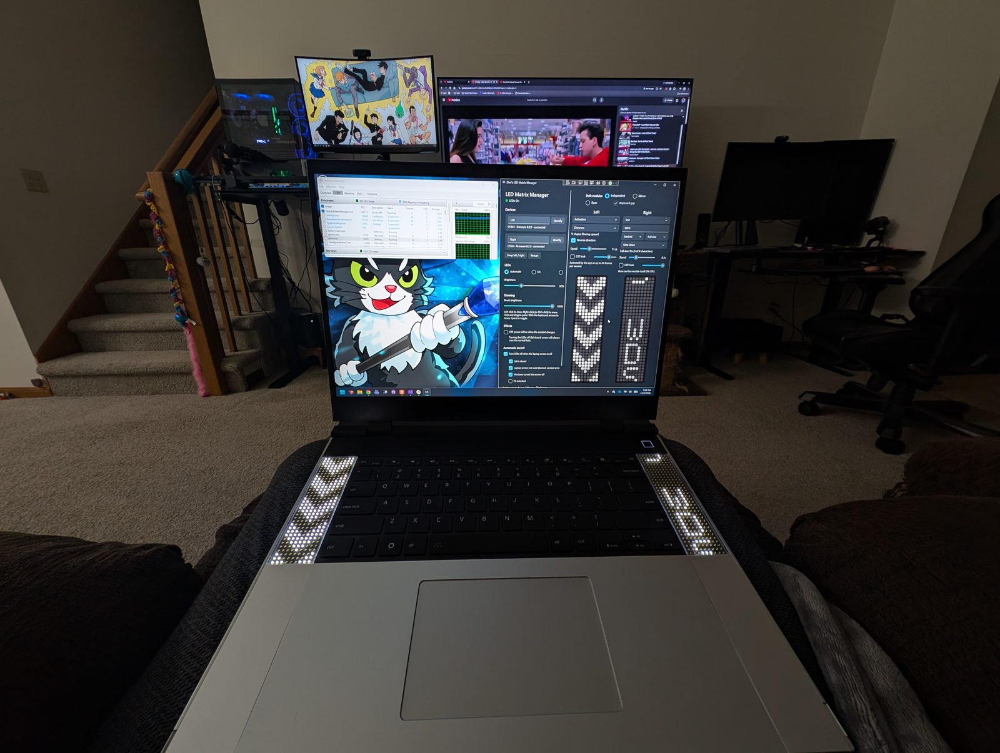
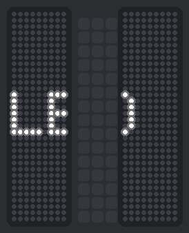
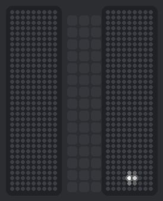
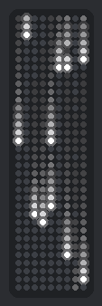
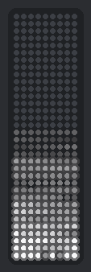
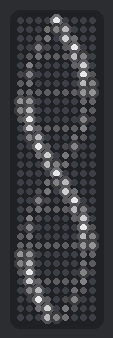
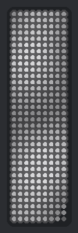
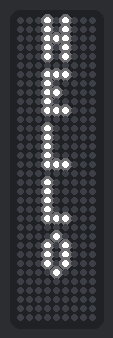
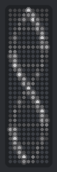
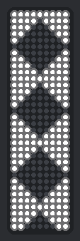

# Deo's Framework 16 LED Matrix Manager

A lightweight Windows tray app for the Framework Laptop 16 **LED Matrix** input modules. Draw, animate, write text, and let the LEDs turn themselves off when you dock and close the lid.

<p align="center">
  <a href="docs/media/WDS_FrameworkLaptop.jpg"></a>
</p>

<p align="center">
  
  &nbsp;&nbsp;
  
</p>

**Website:** https://deovandski.github.io/Deo-s-Framework16-LED-Matrix-Manager/ · **Download:** [latest release](https://github.com/Deovandski/Deo-s-Framework16-LED-Matrix-Manager/releases/latest)

## What it does

- **Both modules, side by side.** Left and Right canvases laid out the way the modules sit next to your keyboard, found automatically. Show different things on each, **mirror** one onto both, or **span** one picture across both (edge to edge, or with a keyboard gap).
- **Animations that loop perfectly.** 16 built in, from digital rain to a DNA helix, and most can play in reverse. Every looping animation returns exactly to its first frame (a unit test checks each one), so there's never a jump. Seam-free downward scrolls are handed to the module's own firmware and use **0% CPU**.
- **Text.** Type something and it's fitted to the module: stacked, sideways or as a ticker, still or sliding. Use `{time}`, `{date}`, `{battery}`, `{cpu}` or `{ram}` for live values.
- **CRT effects.** A retro scanline look over anything, a "No signal" screen, and an optional old-TV power off/on when the content changes.
- **Turns off with the laptop screen.** Docked with the lid closed, "Second screen only", or the screen timing out: the LEDs fade out, whatever is playing. They come back when the laptop screen does.
- **Lives in the tray.** Starts with Windows, idles at about 0% CPU, and remembers your drawings, animations and module names. Default brightness is 39%. 🎤
- **Native and light.** C# / .NET 10 / WPF with the Windows 11 Fluent theme. No admin rights, no drivers, no telemetry.

## Gallery

Rendered by the app's own animation engine (`tools/FrameDump`), so this is exactly what the modules show.

| Digital rain | Fire | Helix | Plasma | Heartbeat | Text | CRT look | Power off/on |
|:---:|:---:|:---:|:---:|:---:|:---:|:---:|:---:|
|  |  |  |  |  |  |  |  |

Also included: marching stripes, checker march, chevrons, diamonds, sine wave, equalizer, snowfall, breathing, bouncing ball, Game of Life and No signal. All the patterns from the official web tool are there too, plus a pixel editor with greyscale brushes.

## Install

1. Download `DeoLedMatrixManager-Setup-x.y.z.exe` from the [latest release](https://github.com/Deovandski/Deo-s-Framework16-LED-Matrix-Manager/releases/latest).
2. Run it. It installs just for you and needs no admin rights. The installer isn't code-signed yet, so Windows SmartScreen may warn you: choose **More info**, then **Run anyway**.
3. Find the LED icon in the system tray. Click it to open the editor; right-click it for quick options.

Only one app can talk to a module at a time, so close the web tool or Framework's `inputmodule-control` while this is running.

## Build from source

You need Visual Studio 2026 with the **.NET desktop development** workload (or the .NET 10 SDK). Open `LedMatrixManager.slnx` and press **F5**. Full details are in [docs/DEV-SETUP.md](docs/DEV-SETUP.md).

```
src/LedMatrix.Core          protocol, frames, patterns, animation engine, text, CRT effects, settings
src/LedMatrix.App           WPF tray app (window, LED editor, detection, screen monitoring)
tests/LedMatrix.Core.Tests  xUnit tests (no hardware needed)
tools/FrameDump             renders the README GIFs from the engine (see tools/make_gifs.py)
installer/                  Inno Setup script
site/                       GitHub Pages website
docs/                       requirements, developer setup, protocol notes, proposals
```

Docs: [Requirements](docs/REQUIREMENTS.md) · [Developer setup](docs/DEV-SETUP.md) · [LED Matrix protocol notes](docs/PROTOCOL.md) · [Animation, text and CRT proposal](docs/proposals/ANIMATION-TEXT-CRT.md)

## Disclosure

**Not affiliated.** This is an independent community project. It is not affiliated with or endorsed by Framework Computer Inc. "Framework" is a trademark of its owner.

**Sources and credits.** This project was built from public information and open-source work. Thank you to:

| Source | What we used | License |
|---|---|---|
| [FrameworkComputer/inputmodule-rs](https://github.com/FrameworkComputer/inputmodule-rs) | The LED Matrix serial protocol, command IDs, sleep and idle-timeout behavior, USB IDs and firmware scroll, all read from its firmware source and `commands.md`. | MIT |
| [FrameworkComputer/dotmatrixtool](https://github.com/FrameworkComputer/dotmatrixtool) ([ledmatrix.frame.work](https://ledmatrix.frame.work)), based on [stefangordon/dotmatrixtool](https://github.com/stefangordon/dotmatrixtool) | The two-matrix layout the app's UX follows, and the black/white pattern definitions (checkerboards, diagonal lines, rows/columns, diamond, scatter), ported to C#. | MIT |
| [Framework Wiki: LED Matrix Manager](https://framework.wiki/docs/community-projects/led-matrix/led-matrix-manager/) and the LED Matrix community projects section | Background research and pointers to the official tools and hardware docs. (We did not use code from FabulousCodingFox's LED Matrix Manager.) | — |
| [Framework Community forum](https://community.frame.work/t/how-can-i-keep-the-framework16-led-matrix-on-constantly/69484) | Confirmation of the 60-second idle timeout and the keep-alive approach. | — |
| Microsoft Learn: [Power setting GUIDs](https://learn.microsoft.com/windows/win32/power/power-setting-guids), [QueryDisplayConfig output technologies](https://learn.microsoft.com/windows/win32/api/wingdi/ne-wingdi-displayconfig_video_output_technology), [WPF Fluent theme](https://learn.microsoft.com/dotnet/desktop/wpf/whats-new) | How the app detects the lid, the laptop panel and screen power, and the Windows 11 look. | Docs |

The license notices for the MIT-licensed sources are in [THIRD-PARTY-NOTICES.md](THIRD-PARTY-NOTICES.md).

**AI assistance.** Much of this project was designed and written with help from Claude (Anthropic). Commits it contributed to are marked `Co-Authored-By: Claude`. The maintainer reviews the changes and tests them on a Framework Laptop 16.

## License

[MIT](LICENSE) © 2026 Deovandski Skibinski Junior
